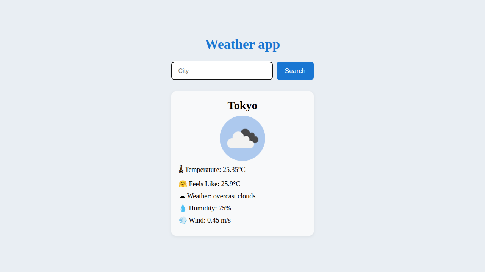

# Weather App

A simple Weather application built with Vanilla JavaScript that allows users to search for any city and view its current weather using the OpenWeather API.

## Features

- Search weather by city name
- Display current temperature
- Display "feels like" temperature
- Display weather description
- Display humidity
- Display wind speed
- Display weather icon
- Loading state while fetching data
- Error handling for invalid cities or network failures
- Responsive layout

## Technologies

- HTML5
- CSS3
- JavaScript (ES6)
- Fetch API
- Async/Await
- OpenWeather API

## Project Structure

```
weather-app/
├── index.html
├── style.css
├── app.js
└── screenshots/
    └── weather-app.png
```

## Getting Started

1. Clone the repository.
2. Get a free API key from OpenWeather.
3. Replace:

```javascript
const API = "YOUR_API_KEY";
```

with your own API key.

4. Open `index.html` in your browser.

## What I Learned

This project helped me practice:

- Fetch API
- Async/Await
- Consuming REST APIs
- JSON parsing
- Error handling
- DOM manipulation
- Loading states
- User input validation
- Working with external APIs

## Future Improvements

- 5-day forecast
- Search history
- Geolocation support
- Temperature unit conversion (°C / °F)
- Dark mode
- Recent searches

## Screenshot

